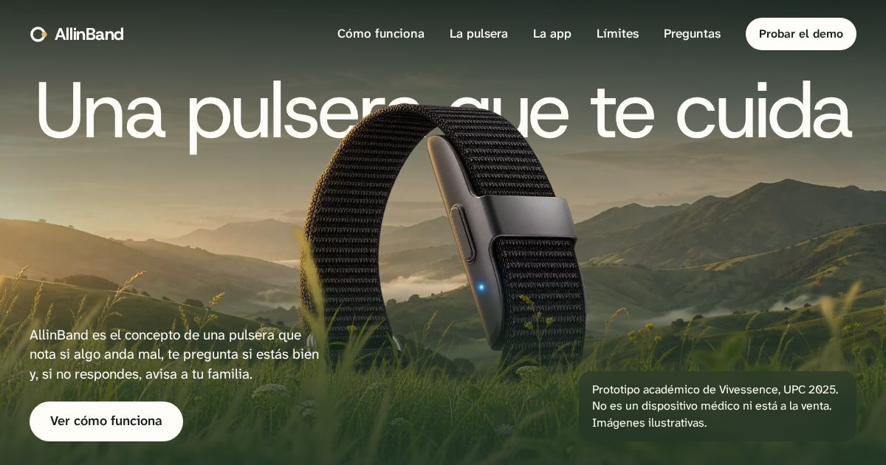

<div align="center">
  
</div>

# AllinBand

> Una pulsera que te cuida.

Landing del concepto AllinBand: una pulsera que nota si algo anda mal, te pregunta si estás bien y, si no respondes, avisa a tu familia y a un centro de salud.

**Es un proyecto académico.** No es un dispositivo médico, no está a la venta y la página no recoge datos. Las cifras son objetivos de diseño del informe del curso, no resultados medidos. Las imágenes son ilustrativas.

[Ver la demo](https://allin.jahattrinidad.com/)



## Ejecutar en local

Es un sitio estático, sin instalación ni paso de build. Las fuentes solo cargan con un servidor (el navegador las bloquea en `file://`):

```bash
git clone https://github.com/trinity-bytes/allin-band.git
cd allin-band
python3 -m http.server 8000
```

## Recorrido de la página

| Sección | Qué cuenta | Movimiento |
|---------|------------|------------|
| Hero | La pulsera entre el paisaje y el pasto | Entrada por etapas y profundidad con el puntero |
| Una emergencia no avisa | El problema, con cifras de supervivencia | Aparece al entrar en pantalla |
| Una mañana cualquiera → Pensada para todos los días | El día con la pulsera, la pregunta, la alerta, la app y el uso diario | En escritorio se recorre en horizontal; el pulso cambia de ritmo según el momento |
| Metas de diseño | Objetivos del informe sobre la curva de la pulsera | Las metas se dibujan a lo largo de la curva |
| Lo que no puede hacer · Preguntas | Límites honestos y preguntas frecuentes | — |
| Quién está detrás | Equipo y código abierto | La palabra AllinBand sale del pasto al llegar al final |

## Estructura

```
index.html            Página única
css/
  variables.css       Tokens: bosque, blanco cálido, ámbar, bruma, tipografía
  reset.css           Reset
  base.css            Fuentes, foco, salto al contenido, bruma y botón
  nav.css             Barra de navegación y menú móvil
  hero.css            Capas del hero y su entrada
  sections.css        Secciones 02, 08, 09 y 10
  journey.css         Secciones 03 a 07 y el recorrido horizontal
  closing.css         Equipo, pie y su movimiento
js/
  main.js             Menú, banda de bruma al hacer scroll, sección activa
  hero.js             Entrada y profundidad del hero
  sections.js         Apariciones al entrar en pantalla
  journey.js          Recorrido horizontal, pulso y línea de tiempo
  closing.js          Movimiento del cierre
assets/
  brand/              Logo, favicon e ícono táctil
  fonts/              Atkinson Hyperlegible Next, Host Grotesk
  images/web/         Imágenes WebP en varios tamaños; og-image.jpg para compartir
tests/                Pruebas de navegador (Playwright, fuera del repositorio)
```

## Decisiones

| Tema | Decisión |
|------|----------|
| Sin JavaScript | Todo el contenido está en el HTML y se lee completo; el recorrido horizontal pasa a vertical. |
| Movimiento | Solo `transform`, `opacity` y trazos SVG. Con `prefers-reduced-motion` no se anima nada; en pantallas táctiles no hay efectos de puntero. |
| Sin terceros | Las fuentes e imágenes se sirven desde el proyecto. |
| Texto que escala | Tamaños en `rem`, respetan la letra elegida en el navegador. |
| Superficie propia | "Bruma": velo musgo con desenfoque, solo sobre fotos, sin bordes ni sombras. |
| Accesibilidad | Objetivo WCAG 2.2 AA. |

## Pruebas

Usan Playwright instalado fuera del repositorio; no es una dependencia del sitio. `reflow.cjs` necesita el Chromium completo, porque el modo headless ignora la preferencia de tamaño de letra.

```bash
export PLAYWRIGHT_CORE_PATH=/ruta/a/playwright
export CHROMIUM_PATH=/ruta/a/chromium
node tests/skip-link.cjs   # el primer Tab llega a «Saltar al contenido»
node tests/reflow.cjs      # texto de 28 px a 360 px sin scroll horizontal
node tests/sections.cjs    # secciones 02, 08, 09, 10, sin JS y FAQ por teclado
node tests/journey.cjs     # recorrido horizontal, anclas, teclado y pulso
node tests/interactions.cjs # posición al redimensionar, navbar activo, enlaces finales y texto grande
```

## Equipo

**Vivessence**: Tamara Guzman, Mariana Morocho, Fabrizio Santi y Jahat Trinidad. Curso Arquitectura de Computadoras, UPC 2025.
